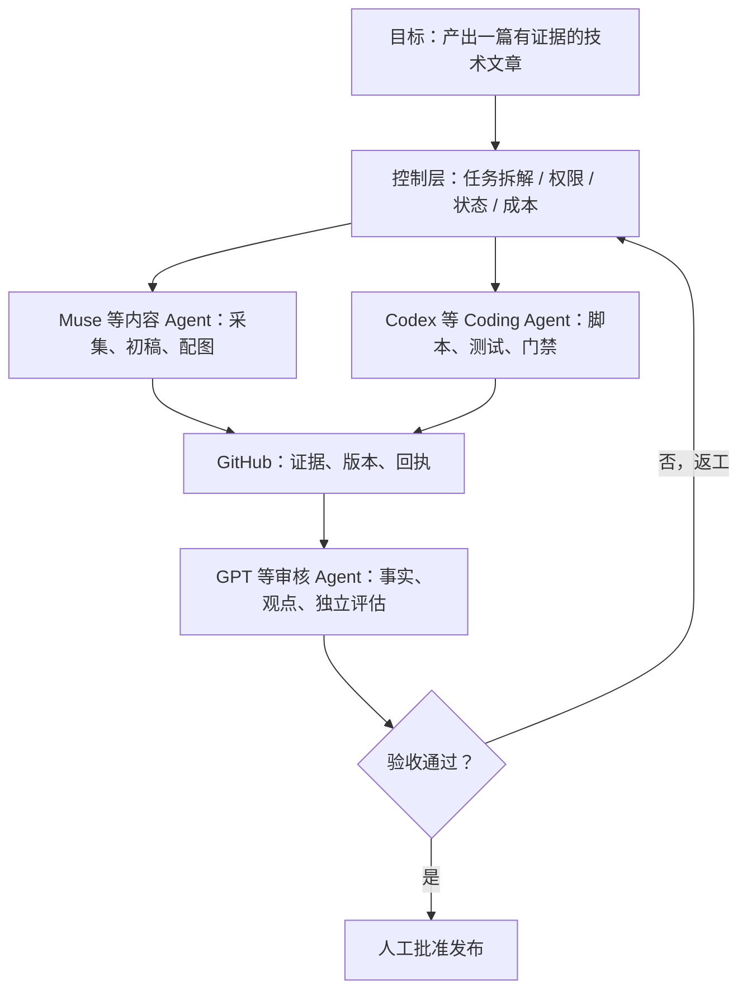
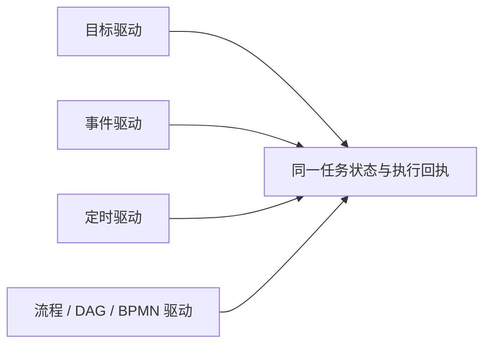

# 从一个人手动接力三个 AI，到 Super Agent 协作体系

> 文章草案｜未完成资料最终核验与人工发布审核，禁止自动发表。主题：DeepSeek Super Agent 启发下的行途工程探索。

我最近发现了一个有点尴尬的事实：手边已经有 GPT、Muse、Codex，以及不同的桌面和编码 Agent，工具越来越多，我自己却变成了它们之间的“消息队列”。

GPT 给出方案，我复制给 Muse；Muse 生成内容和代码，把结果放进 GitHub；我再把链接搬回 GPT 做审核。每个 Agent 单独看都能干活，但围绕同一个目标协作时，仍然需要我不断确认“版本是什么、谁做完了、下一步交给谁”。

这件事的瓶颈不是模型不够聪明，而是**目标、状态、授权与回执没有贯通**。

## DeepSeek Super Agent 给我的启发

DeepSeek 发布的 [dsh-superagent-prototype](https://github.com/deepseek-ai/dsh-superagent-prototype) 是一个研究原型，附有哲学、领域模型与架构文档。它关注减少人的注意力负担，以 Source / Trigger / Policy / Executor / Outbox 等机制组织任务。官方并没有将其宣称为一个成熟的通用跨平台产品；部分理念与公开实现也不完全相同。

我尝试用工程组合方式表达自己的理解：

> **Super Agent 能力体系 ≈ LLM + Harness + Event Bridge / Orchestrator 的协同扩展。**

这并非 DeepSeek 官方的数学公式，更不是要取代 DeepSeek Super Agent。LLM 负责理解与推理，Harness 提供执行约束、工具与 Skills；我们要补的是跨已有 Agent 的协作连接：如何交接、怎么判断谁有权执行、怎样发现重复动作和假成功。一个 Super Agent 可以是我们的入口，也可以成为参与专业分工的执行器。

## 不是再造一个 Agent

这张图不是我们已经部署好的自动化系统，而是 Event Bridge 的目标工作流。设计里，Coding Agent、Work Agent、Personal Agent 不是竞争入口，而是根据目标动态选择的能力。

## 为什么现实比流程图难

我们自己的定时任务审计已经出现过典型问题：任务登记与平台实际配置漂移；某些数据报表更新了，但上游快照没有新数据；多个 Agent 对同一对象重复巡检。一次运行“成功”的文字提示，并不能证明最终结果正确。

因此 Event Bridge 最小版本先定义 Task、Event、Receipt，并以唯一任务 ID、版本指纹、幂等、权限门禁和独立验证建立可恢复的执行闭环。Watchdog 应当按证据发现问题，而不是每隔几分钟再叫一个大模型问“现在怎么样了”。

## 四种驱动模式并存

BPMN 适合可视化的业务流程与显式审批，事件机制适合变化触发，定时任务适合周期性检查，目标驱动适合开放任务。没有必要让一种范式取代其他三种。

## 行途的切入点

目前原型在 [xingtu-harness 的 Event Bridge Draft PR](https://github.com/xingtu1996/xingtu-harness/pull/4)；它只有离线模拟 Worker、任务状态与测试代码，尚未接通任何真实 GPT/Muse/Codex 会话，也没有完成持久化与生产部署。

接下来优先验证：不再由人复制任务包；同一事件重投不重复生成产物；一份 PR 的审核结果能够绑定确定的提交；任务失败后能从回执和执行证据判断是否安全重试。

我们不会再造 Claude Code，也不打算把现有 Harness 全部重构。更值得建设的是一个由用户掌控、与产品无关的轻协同层，用已有 Agent 的长处完成目标。

## 商业价值应建立在结果上

未来也许能够从个人多工具工作台，延伸到团队协同、私有化治理和行业模板。但这些是待验证假设，不是已经实现的商业成果。第一步甚至不是收费，而是让一个不认识我们的开发者，使用开放模板在自己的环境里复现一个真实工作流。

衡量成功的标准应该是：**人工交接少了多少、重复执行有没有减少、合格成果的成本是否下降、关键授权有没有被守住。**

## 参考资料

1. DeepSeek 官方研究原型：[dsh-superagent-prototype](https://github.com/deepseek-ai/dsh-superagent-prototype)。
2. DeepSeek：[000 Philosophy](https://github.com/deepseek-ai/dsh-superagent-prototype/blob/main/docs/000-philosophy.md)。
3. DeepSeek：[001 Domain Model](https://github.com/deepseek-ai/dsh-superagent-prototype/blob/main/docs/001-domain.md)。
4. DeepSeek：[007 Architecture](https://github.com/deepseek-ai/dsh-superagent-prototype/blob/main/docs/007-architecture.md)。
5. GitHub：[Events that trigger workflows](https://docs.github.com/en/actions/reference/workflows-and-actions/events-that-trigger-workflows)。

*本文为技术实践探索草案，相关产品能力及论文发表状态均应在公开发表前再核验。*
