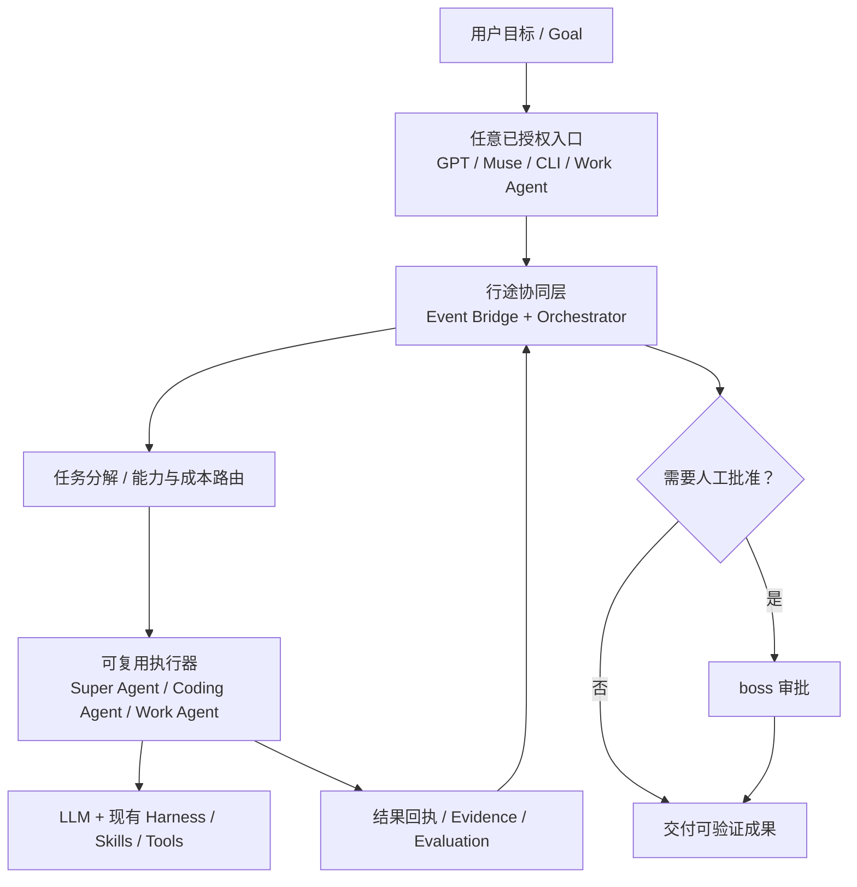

# 设计哲学｜Super Agent 协作扩展，而不是替代

> 2026-11-02，探索性设计。引用与能力声明须区分“官方实现”“借鉴原理”“行途设想”“已验证代码”。

## 设计公式

**Super Agent 能力体系 ≈ LLM + Harness + 行途 Event Bridge / Orchestrator 的协同扩展**

这是行途的工程组合表达，**不是 DeepSeek 官方提出的等式**，也不是宣称 DeepSeek 的 Super Agent 缺少这些模块。LLM 做目标理解、判断与推理；Harness 承载 Skills、工具、上下文和执行约束；Event Bridge / Orchestrator 解决不同产品、不同专业执行器之间的可验证交接。可将已有 Super Agent 当作一个入口或 Worker。

## 十条原则

1. **目标优先**：用户表达目标、边界和验收标准，不必从一堆工具中手工寻找工作入口。
2. **不替代生态**：Claude Code / Codex / OpenCode / Muse / WorkBuddy / 豆包工作等保留各自能力与优势。
3. **借鉴成熟架构**：优先复用 DeepSeek Super Agent、现有 Harness、CI、Webhook、BPMN/DAG、工作流引擎的成熟能力，不重新发明执行器。
4. **能力按证据接入**：API/CLI/Hook/Webhook 可用性与用户授权逐项核验；缺乏接口时允许人手交接，不虚构直接控制能力。
5. **专业分工**：按可用能力、成本、成功率、隐私和任务风险分配，而不是绑定单个模型的强弱标签。
6. **最小控制平面**：只补统一 Task/Event/Receipt 契约、任务状态、权限、路由和可观测缺口。
7. **驱动模式共存**：目标驱动、事件驱动、定时驱动、BPMN/DAG/代码流程按场景组合；不把 BPMN 误写成自主推理引擎。
8. **可验证结果**：产物、日志、提交 SHA 与独立验收优于“Agent 说已完成”。
9. **保护人类注意力**：正常静默，只有需要授权、新异常和可用成果时提醒。
10. **真实验证后推广**：先在行途私有内容场景试验，公开模板不依赖私有路径、Token 或厂商优惠。

## 系统关系图

## 与上游 DeepSeek Super Agent 的关系

- 主要启发：[DeepSeek 官方开源研究原型](https://github.com/deepseek-ai/dsh-superagent-prototype)。
- [000-philosophy](https://github.com/deepseek-ai/dsh-superagent-prototype/blob/main/docs/000-philosophy.md)：人类注意力与代理自治。
- [001-domain](https://github.com/deepseek-ai/dsh-superagent-prototype/blob/main/docs/001-domain.md)：Source、Trigger、Ticket、Mandate、Executor 等领域实体。
- [007-architecture](https://github.com/deepseek-ai/dsh-superagent-prototype/blob/main/docs/007-architecture.md)：Source、Engine、Policy、Store、Outbox、Executor 分层。

**不宣称官方合作、兼容性已验证、已有正式学术论文或已经实现全面自主协作。** 该原型是研究项目，引用它是尊重其技术思想的来源；我们的贡献是自身场景下跨工具适配和专业协作的实验结果。

## 当下与未来

当下：`bridge.py` 是内存中的 mock Muse 与 mock Codex，只能证明协议和状态机的极小样例。未来：基于用户实际授权能力实现适配器、持久化、异步任务恢复、权限门禁、成本评测。不能将未来状态写成现有功能。

## 开源矩阵演进原则

产品可牵头标准、兼容矩阵和跨仓升级，但每个仓保留独立职责与维护权。所有跨仓升级采用独立 PR；不因为本产品的新架构就批量改动生产调度。
