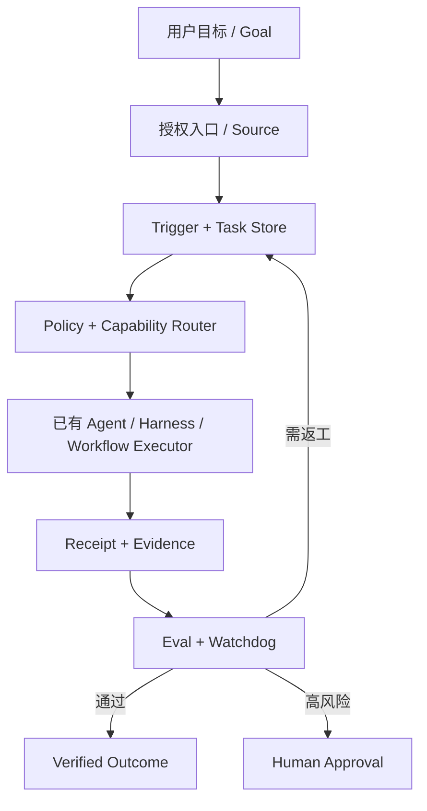

# XSA 架构与 DeepSeek 设计映射

## 领域映射

| DeepSeek Super Agent 概念 | XSA 构想 | 边界 |
|---|---|---|
| Source / Trigger | 多入口与事件适配 | 不声称能读取任意聊天软件 |
| Mandate / Authorization | 任务授权与权限门禁 | 授权不能由模型推断 |
| Ticket / Assignment | Goal / Task / Lease | 单写入者和事务去重 |
| Executor | 复用已有 Agent 或 Harness | 不重复实现 Coding Agent |
| Outbox / Reply | Receipt / Evidence / Notification | 回执与通知分离 |
| Philosophy | 最小化人的注意力占用 | 默认静默、只在关键节点打扰 |

## 四驱动

Goal / Event / Schedule / Workflow(DAG/BPMN) 都转成有身份的 Task/Event，统一走权限、状态和回执。BPMN 是强约束业务流程的一种表示，并非推理模型。

## 第一阶段不能承诺

无法直接控制无开放接口的 GPT/Muse/豆包等聊天会话；用户已有订阅不等于免费 API；Watchdog 需真实证据；没有事务和租约就不能部署多 Worker 生产。
